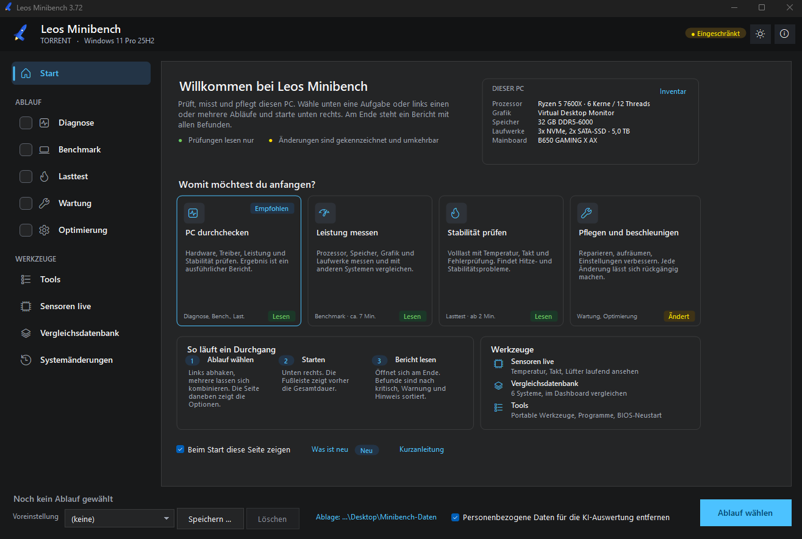
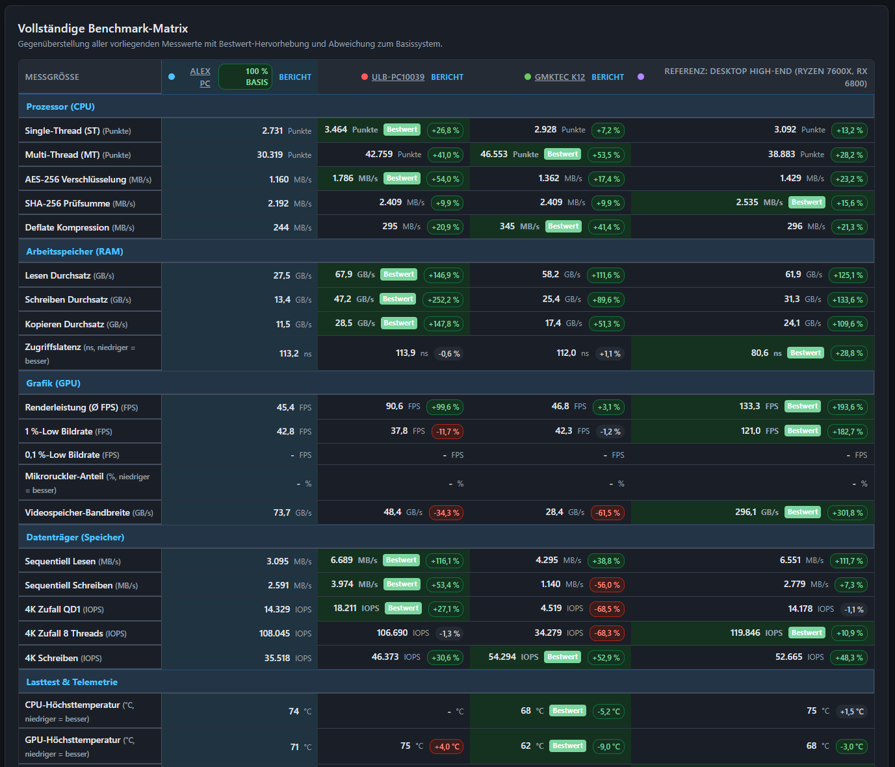
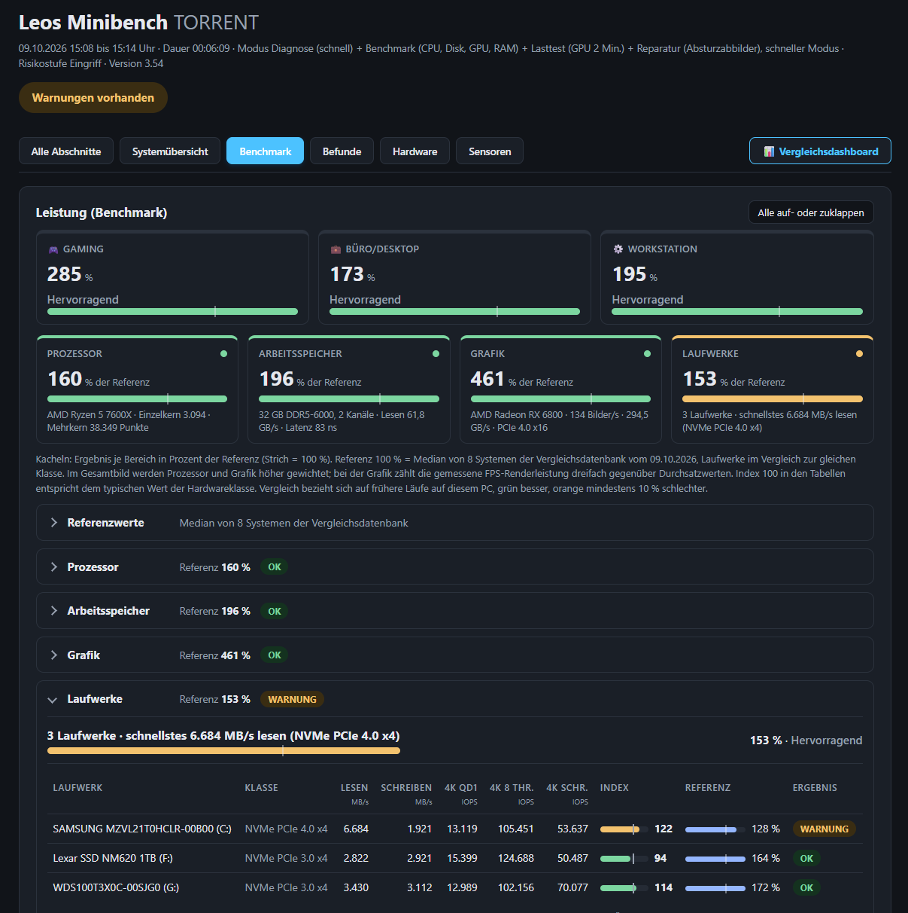



# Leos Minibench (LMB)

**Portable Diagnose-, Benchmark-, Stresstest-, Reparatur- und Optimierungs-Suite für Windows 10 & 11.**

[-0078d4.svg)]()

 

> **🛡️ 100 % Offline, Open Source & Transparent**  
> Leos Minibench enthält keinerlei Telemetrie, keine Werbekomponenten, keine Cloud-Anbindung und keine Hintergrunddienste. Alle Diagnose-, Benchmark-, Wartungs- und Backup-Aktionen laufen transparent, nachvollziehbar und rein lokal auf dem jeweiligen Rechner bzw. USB-Stick.

 

  

  

  
  &nbsp;
  

---

## 🚀 Schnellstart

1. **[LMB.exe über GitHub Releases herunterladen](https://github.com/miniLeonardo/MiniBench/releases)** (oder direkt auf einen USB-Stick kopieren).
2. Per Doppelklick als **Administrator** starten (UAC bestätigen).
3. Gewünschte Module wählen und **Start** klicken. Alle Berichte, Datenbankeinträge und Änderungsprotokolle landen im Ordner `Minibench-Daten\` neben der Programmdatei.

Alternativ kann die Suite ohne Binärdatei direkt per PowerShell über `LMB.cmd` bzw. `LeosMinibench.cmd` gestartet werden.

**Aktualisieren:** Liegt auf GitHub eine neuere Version, erscheint oben rechts „Update verfügbar“. Ein Klick lädt die neue `LMB.exe`, prüft ihre SHA-256-Prüfsumme, sichert die alte Version unter `Minibench-Daten\Archiv` und startet neu. Der Verlauf steht in `Minibench-Daten\Update\Update.log`. Die Prüfung lässt sich in den Einstellungen (Zahnrad) abschalten.

---

## 🆕 Neu in 4.0x

* **4.04:** Referenz wird in der Datenbank festgelegt (Haken auf der Seite Benchmark entfällt), Veröffentlichen in einem Schritt.
* **4.03:** Update-Funktion repariert (tauschte bis dahin nicht die Programmdatei), SMART-Langtest wird vor Messungen beendet, PCIe-Anbindung der Grafik unter Last gemessen, aufgeräumte Datenbank-Leiste mit Menü *Aktionen*.
* **4.02:** PawnIO-Treiber wird nach dem Lauf wieder entfernt, Laufwerke mit unbekanntem Medientyp werden eingeordnet, Ergebnisseite ordnet gegenüber dem Referenz-PC ein statt gegenüber einem Durchschnitt, Einstellungen auf einer Seite, Zustand der Optimierung im Hintergrund.
* **4.01:** Ergebnisseite mit Urteil, To-dos und Vergleich, kürzere Startzeit (3 bis 5 s vom Stick), korrekte Schriftgrößen bei 125 und 150 % Skalierung.

Alle Versionen: [CHANGELOG.md](CHANGELOG.md), Einzelheiten je Version in `Doku\Änderungen_vX.Y.txt`.

---

## 🌟 Funktionsübersicht

* **Startseite & Hardware-Steckbrief:** Sofortige Erkennung aller Schlüsselkomponenten (CPU, GPU, RAM, Datenträger, Mainboard) beim Start. Automatische Konfigurationsprüfung deckt typische Leistungsbremsen ohne Klick auf: inaktive Speicherprofile (XMP/EXPO), auf 60 Hz limitierte Gaming-Monitore, falsche Display-Anschlüsse (Mainboard-iGPU statt dGPU) sowie veraltete BIOS-Versionen mit Hersteller-Links.
* **Diagnose:** Vollständiges Hardware- und System-Audit, Festplatten-Gesundheit (SMART-Werte über smartctl), Akku-Verschleiß, BlueScreen- und Absturzanalyse sowie Ereignisprotokoll-Inspektion. Beinhaltet eine detaillierte Windows-Startzeit-Analyse (Event ID 100) mit Trennung von `MainPathBootTime`, `BootPostBootTime` und UEFI-POST-Dauer.
* **Benchmark:** Echte Messungen ohne WinSAT-Altlasten. CPU-Performance (Single- und Multi-Core, Hardware-Krypto AES/SHA, Deflate), realer RAM-Durchsatz (Lesen, Schreiben, Kopieren) samt Latenzmessung in Nanosekunden, Datenträger-Dauertransferraten und sequenzielle/zufällige I/O sowie nativer Direct3D 11 GPU-Rendertest mit präziser Erfassung von FPS, Frametimes und 0,1 %-Lows.
* **Lasttest & Telemetrie:** Isolierte oder kombinierte Stresstests für Prozessor, Arbeitsspeicher und Grafikkarte. Echtzeit-Erfassung von Temperaturkurven, Taktraten und Leistungsaufnahme mit automatischem Drosselungsnachweis (thermisch, VRM, Leistungsbudget) und konfigurierbaren Notabschalt-Schwellen.
* **Wartung & Reparatur:** Integrierte Systemdateireparatur (SFC, DISM), Windows-Update-Reset, Netzwerk- und Winsock-Rücksetzung, Freigabe von Speicherplatz durch Bereinigung veralteter Komponentenspeicher (WinSxS) sowie saubere Grafikkartentreiber-Vorbereitung (DDU).
* **Optimierung:** Über 160 praxisnahe Windows-Tuning-Optionen in 14 Kategorien (Datenschutz, Telemetrie, Gaming-Latenzen, Dienste und visuelle Effekte). Jede Maßnahme besitzt eine definierte Risikostufe, wird im Änderungsprotokoll erfasst und kann jederzeit einzeln oder als Gruppe wieder rückgängig gemacht werden.
* **System-Umzug:** Transparente Sicherung persönlicher Daten, Bibliotheken, Desktop-Layout und Programme vor einer Windows-Neuinstallation auf Wechsellaufwerke oder Netzlaufwerke inklusive 1-Klick-Wiederherstellung. Sicherheitskritische Daten (wie Browser-Passwörter oder Zugangsdaten) werden aus Datenschutzgründen prinzipbedingt ausgeschlossen.
* **Interaktives HTML5-Dashboard:** 100 % offline-fähiges Fluent 2-Dashboard für flexible Multi-System-Vergleiche. Ermöglicht die synoptische Gegenüberstellung beliebiger Systeme aus der Datenbank gegen hinterlegte Referenzprofile (Desktop High-End, Mittelklasse, Notebook, Mini-PC), inklusive Bestwert-Hervorhebung, Canvas-Sensorverlaufskurven (mit Benchmark-Fallback) und physikalischem 230V-Netzteil-Effizienzkalkulator mit EU-Wirkungsgradkurven (80 PLUS).

---

## 🔒 Sicherheit & Zero-Footprint

* **Keine Rückstände (Zero-Footprint):** Alle erzeugten Daten verbleiben im Ordner `Minibench-Daten\` auf dem Stick. Am Ende jedes Durchlaufs prüft eine Rückstandskontrolle das Zielsystem und entfernt temporäre Spuren vollständig.
* **Vollständiges Rollback:** Jede Systemänderung wird mit Zeitstempel, Originalwert und Gegenbefehl im Änderungsprotokoll dokumentiert. Über die Seite *Änderungen* können Anpassungen gezielt zurückgesetzt werden.
* **Sicherheitseingriffe:** Vor tiefgreifenden Eingriffen wird automatisch ein Windows-Systemwiederherstellungspunkt angelegt. Zerstörende Aktionen (z. B. Laufwerksbereinigungen) erfordern die Bestätigung der Seriennummer.
* **Anonymisierte KI-Diagnosedatei:** Erzeugt zu jedem Lauf eine datenschutzkonforme `KI-Datei.txt`, die direkt in moderne Sprachmodelle (Gemini, Claude, ChatGPT) eingefügt werden kann, um gezielte Handlungsempfehlungen zu erhalten.

---

## 📊 Beispielberichte

* 📊 **[Beispiel-Dashboard (HTML)](Doku/Beispiele/Beispiel_Dashboard.html)** – Interaktives Benchmark- & Diagnose-Dashboard mit Multi-System-Vergleich, 230V-Netzteil-Kalkulator und Sensor-Zeitreihen.
* 📈 **[Beispiel-Systemvergleich (HTML)](Doku/Beispiele/Beispiel_Systemvergleich.html)** – Synoptische Gegenüberstellung mehrerer Rechner aus der Datenbank.

---

## 🛠️ Für Entwickler

* **Architektur:** Windows PowerShell 5.1 und C# 5 (Add-Type / `csc.exe`). Keine externen Laufzeitabhängigkeiten, keine Cloud- oder CDN-Erfordernisse.
* **Testsuite:** `Testen.cmd` führt über 840 Pester-Tests aus (kompatibel mit Pester 5 und Pester 6).
* **Build-Prozess:** `Bauen.cmd` prüft den Quelltext laut `src\Bauplan.txt`, führt die Pester-Tests aus, kompiliert `LMB.exe` lokal und führt nach erfolgreichen Tests einen lokalen Git-Commit durch. Übertragen mit `git push` und dem Tag `vX.Y`.
* **Release:** `Veroeffentlichen.ps1` überträgt `main` und den Tag, richtet bei Bedarf die GitHub CLI ein und erstellt das Release der aktuellen Version mit `LMB.exe` und der SHA-256-Zeile, die die Update-Funktion prüft.
* **Richtlinien:** Details zu Codestil, Modulverträgen und Beitragsrichtlinien sind in [AGENTS.md](AGENTS.md) dokumentiert.

---

## 👏 Danksagung & Quellen

> Das Modul *Optimierung* basiert auf der hervorragenden Recherche und Skriptsammlung des Projekts [Windows Optimisation Pack von Marvin700](https://github.com/Marvin700/Windows_Optimisation_Pack). Die Maßnahmen wurden in Leos Minibench mit detaillierten Risikostufen, Änderungsprotokollen und vollständiger Rollback-Funktion nativ integriert.

Externe Hilfswerkzeuge werden ausschließlich im Original von den offiziellen Upstreams bezogen und über feste SHA-256-Prüfsummen im Werkzeugmanifest `Tools.json` validiert (LibreHardwareMonitor, PawnIO, smartmontools, Wagnardsoft DDU via winget).

---

## 📄 Lizenz

Dieses Projekt ist unter der [MIT-Lizenz](LICENSE) lizenziert.
